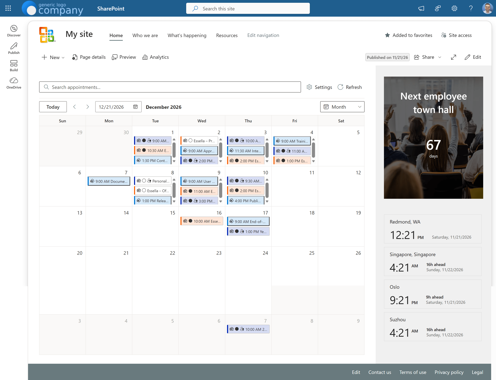

# <picture></picture> My Calendars

📧 Outlook for meetings  
✅ Planner for tasks and deadlines  
💬 Teams for group calendars  
📋 SharePoint for calendars, task lists, project tracking, and more  

Great, until you want to see it all in one place.

**My Calendars** is a free, open-source SharePoint web part that brings your Microsoft 365 schedules together in a single calendar.

Administrators can assign Exchange and SharePoint calendars to Microsoft Entra groups, choosing whether they're mandatory, enabled by default, or optional. They can also offer ICS subscriptions through Outlook.



[Documentation](https://www.m365wizard.com/docs/tools/apps/my-calendars) · [Latest release](https://github.com/DwayneSelsig/spfx-my-calendars-webpart/releases/latest) · [Report an issue](https://github.com/DwayneSelsig/spfx-my-calendars-webpart/issues)

## Features

- View Outlook and shared Exchange calendars, Microsoft 365 Group calendars, Planner tasks, SharePoint list events, and Teams Shifts together.
- Switch between Day, Week, and Month views, search events, and open supported items in their original applications.
- Choose calendars, colors, visibility, and display preferences. Personal settings follow you across SharePoint sites.
- Administrators can set automatic Group/Teams calendar and Teams Shifts loading defaults; both start off and users can choose their own settings.
- Administrators can assign Exchange or SharePoint calendars to Microsoft Entra security groups (or Everyone), and offer ICS subscriptions to those audiences through Outlook.

### Calendar assignments

For Exchange and SharePoint calendars, administrators can decide how assignments appear:

| Policy | Behavior |
| --- | --- |
| **Mandatory** | Always enabled; users cannot hide or remove it. |
| **Default** | Enabled initially; users can hide it. |
| **Available** | Offered to users, who can enable it themselves. |

Administrators can also control which presentation settings users may change. Group assignments do not grant access to Exchange mailboxes or SharePoint lists; existing Microsoft 365 permissions still apply. ICS links open the Outlook subscription flow; My Calendars does not read ICS feeds directly.

[Read the administration guide](https://www.m365wizard.com/docs/tools/apps/my-calendars/administration/entra-group-assignments)

## Getting started

1. [Download the latest `.sppkg` package](https://github.com/DwayneSelsig/spfx-my-calendars-webpart/releases/latest).
2. [In the SharePoint admin center](https://go.microsoft.com/fwlink/?linkid=2185077), open **More features &rarr; Apps &rarr; Open** and upload the package.
3. Enable the app and have an authorized administrator approve the requested Microsoft Graph permissions under **API access**.
4. Add **My Calendars** to a modern SharePoint page.
5. Configure the web part and publish the page.

To upgrade, upload the new package and replace the existing version.

For screenshots, requirements, and configuration steps, see the [installation guide](https://www.m365wizard.com/docs/tools/apps/my-calendars/getting-started/installation).

## Documentation

The [M365Wizard guide](https://www.m365wizard.com/docs/tools/apps/my-calendars) covers setup, personal calendars, Entra group assignments, permissions, and troubleshooting.

Developer references remain in this repository: [architecture](docs/architecture-and-behavior.md), [calendar behavior](docs/calendar.md), [sources and permissions](docs/sources-and-permissions.md), and [settings and policies](docs/settings-and-policy.md).

## Development

```bash
npm install
npm run start    # local development
npm run build    # production package in sharepoint/solution/
```

See [dependency compatibility](docs/dependency-compatibility.md) before changing the build environment.

## Contributing

Contributions are welcome! Bug fixes, improvements, and new features are always appreciated. For larger changes, please [open an issue](https://github.com/DwayneSelsig/spfx-my-calendars-webpart/issues) first to discuss your idea.

Documentation is maintained separately in [M365Wizard](https://github.com/DwayneSelsig/M365wizard). Corrections and improvements can be submitted there.

## License

Licensed under [AGPL-3.0](LICENSE). The icon is from Microsoft Fluent UI System Icons (MIT). Provided as is, without warranty.
